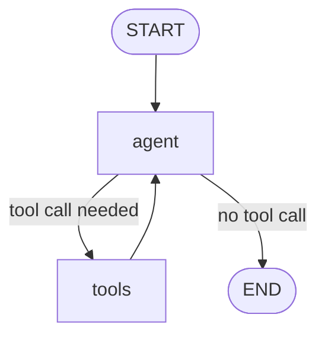

# 🥟 Momo Ghar

An AI waiter for a momo shop, built with **LangGraph**, **LangChain**, **Gemini** and **Express**.

It shows the menu, calculates the bill using a tool, asks the customer for approval before placing an order, and remembers each conversation using a `threadId`.

---

## Features

- Tool calling: `get_menu`, `calculate_bill`, `place_order`
- Human-in-the-Loop: `interrupt()` pauses the graph until the customer approves or rejects the order
- Short-term memory: `MemorySaver` checkpointer keeps the conversation per `threadId`
- Custom state: `messages` plus an `llmCalls` counter with a reducer
- REST API with `/chat` and `/chat/resume`

---

## How It Works



| Tool | What it does |
|---|---|
| `get_menu` | Returns the menu with prices |
| `calculate_bill` | Calculates the total from items and quantities |
| `place_order` | Pauses for approval, then places or cancels the order |

---

## Project Structure

```
momo_ghar/
├── index.js
├── package.json
├── package-lock.json
├── .gitignore
└── README.md
```

---

## Setup

```bash
git clone https://github.com/bisheytechno/momo_ghar.git
cd momo_ghar
npm install
```

Create a `.env` file in the root folder:

```env
GOOGLE_API_KEY=your_google_api_key_here
PORT=8000
```

`package.json` must contain `"type": "module"`.

Run the server:

```bash
node index.js
```

---

## API

### `POST /chat`

| Field | Required | Description |
|---|---|---|
| `prompt` | yes | The customer message |
| `threadId` | no | Reuse it to continue the same conversation |

Normal response:

```json
{
  "status": "completed",
  "threadId": "a1b2c3d4-...",
  "reply": "Here is our menu: ...",
  "llmCalls": 2
}
```

When approval is needed:

```json
{
  "status": "approval_required",
  "threadId": "a1b2c3d4-...",
  "message": "Do you want to confirm this order of Rs 330?",
  "items": [
    { "name": "buff momo", "qty": 2 },
    { "name": "tea", "qty": 1 }
  ],
  "total": 330
}
```

### `POST /chat/resume`

```json
{ "threadId": "a1b2c3d4-...", "answer": "yes" }
```

Send `"yes"` to confirm. Anything else cancels the order.

---

## Example

```bash
curl -X POST http://localhost:8000/chat \
  -H "Content-Type: application/json" \
  -d '{"prompt": "2 plates of buff momo and 1 tea please"}'

curl -X POST http://localhost:8000/chat/resume \
  -H "Content-Type: application/json" \
  -d '{"threadId": "YOUR_THREAD_ID", "answer": "yes"}'
```

---

## Tech Stack

Node.js, Express, LangGraph, LangChain, Google Gemini, Zod

---

## Author

[@bisheytechno](https://github.com/bisheytechno)